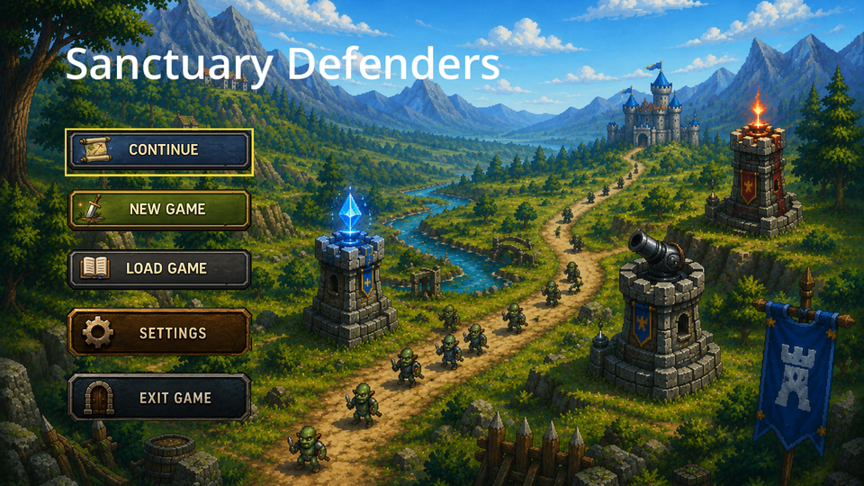
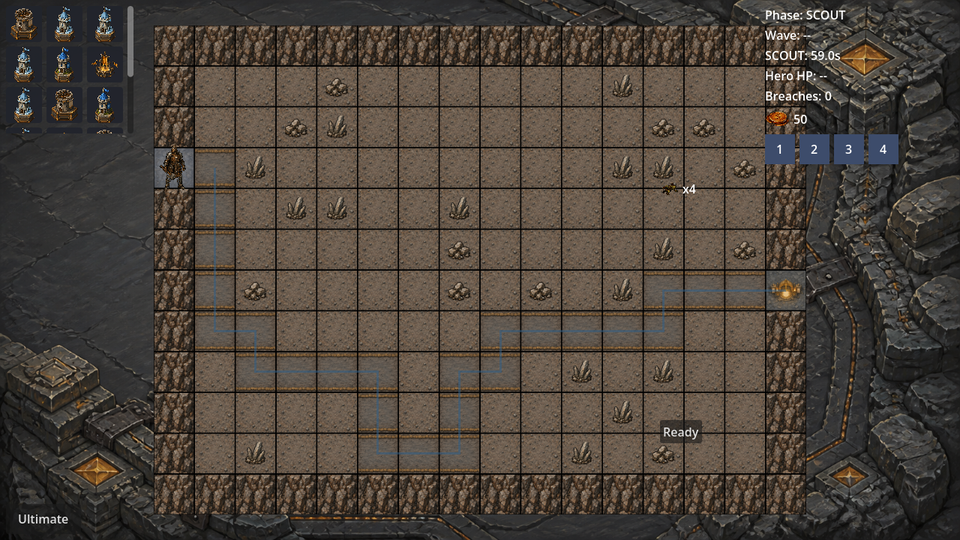
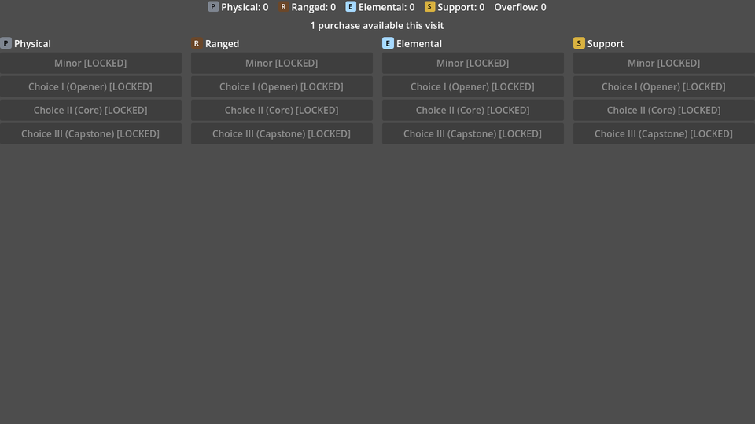
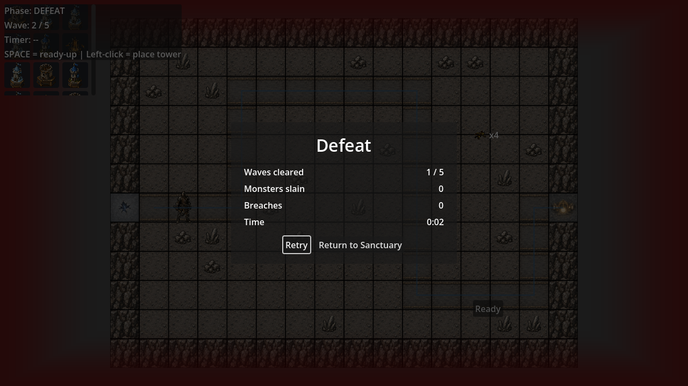
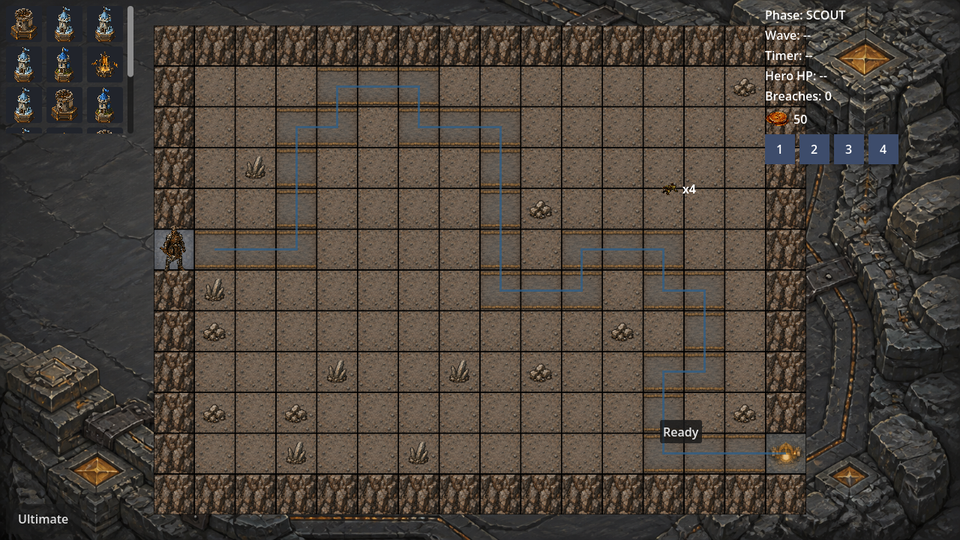

<p align="center">
  <h1 align="center">Sanctuary Defenders</h1>
  <p align="center">
    A hybrid RPG Tower Defense: fight directly as a hero while a network of
    modular towers holds the line, then return to your sanctuary to craft,
    breed, and build a Tarot deck before the next run.
  </p>
</p>

<p align="center">
  
  
  <a href="LICENSE"></a>
  
</p>

---

## What is this?

In every mission you personally control a hero on the field while the towers
you designed and placed do the rest of the work. Between missions you return
to your Sanctuary — a persistent home base — to craft equipment, tend a
creature menagerie, build a Tarot deck, and unlock base upgrades. Three
design pillars govern every decision: **Mastery-as-Vindication** (victory
comes from reading the battlefield correctly, never luck), **Everything
Connects** (nine systems talk through one shared event bus, so any two can
interact), and **The Sanctuary Is Your Statement** (your base is a visible
record of your choices, not a progress bar).

A full player-facing FAQ (mission structure, hero, towers, monsters,
equipment, accessibility) lives in [`design/portfolio-brief.md`](design/portfolio-brief.md)'s
companion documents under `design/gdd/` — start with
[`design/gdd/game-concept.md`](design/gdd/game-concept.md) and
[`design/gdd/game-pillars.md`](design/gdd/game-pillars.md).

| | | |
|---|---|---|
|  |  |  |
|  |  | |

## Status

**Pre-playtest.** Every system below is implemented and covered by automated
tests, but the game has not yet been through a full human playtest pass.
Most sound effects and music are CC0 placeholders standing in for a real
audio pass, a few art pieces are still placeholder, and the project has
chosen a hybrid 3D-world/2D-creatures presentation direction but still runs
its original 2D path day to day pending the remaining art. None of this
blocks reading or running the code — it's an honest status, not a caveat
about whether it works.

## What's built

- **Mission loop** — Scout → Wave → Intermission → Outcome, a penultimate
  all-elite wave, a boss finale, a Victory/Defeat panel with run stats and
  Retry.
- **Hero** — direct movement and combat, 4 active skill slots, a class
  identity earned mid-mission by standing near towers of one archetype,
  wind-up telegraphs on incoming attacks, and full damage/death feedback.
- **Towers** — a 4-slot component system (Foundation/Weapon/Focus/Power,
  plus Shaft/Top), 18 towers across 4 archetypes × 4 tiers, pre-placement
  perks, and geometric constellation bonuses.
- **Monsters** — Standard/Elite/Boss tiers with telegraphed, dodgeable
  attacks and real hit/whiff confirmation.
- **Sanctuary systems** — Crafting, Equipment Forge, Tower Assembly,
  Menagerie (creature happiness feeds material quality), Defense Building
  tech tree, Tarot deck, Hero Skill Tree.
- **Equipment** — base stats on every item, 9 set bonuses, 22 themed runes
  plus 2 wildcards.
- **Audio** — a data-driven cue dispatcher with real-time voice limiting,
  sidechain ducking, world-space distance attenuation, and per-skill/
  per-status-effect cue variant routing; every button gives click/confirm/
  cancel/denial feedback.
- **Accessibility & localization** — reduced motion, no color-only signals,
  4 independent volume sliders, and every player-facing string routed
  through translation keys (guarded by a test that fails on a new hardcoded
  string).

## Tech

Godot 4.6.2, GDScript, built on a single rule: **every system talks only
through one shared `EventBus`**, documented as the project's first of 41
Architecture Decision Records (`docs/architecture/adr-*.md`). 158 scripts,
~38k lines of game code; 289 test files, ~2,946 test functions, more test
code than game code, run automatically on every push and pull request via
[GitHub Actions](.github/workflows/tests.yml).

```
src/            Game source (core, gameplay, ai, networking, ui, tools)
assets/         Art, audio, shaders, data (.tres resources)
design/         Game design documents (gdd, narrative, levels, balance)
docs/           Architecture decisions, engine reference, technical docs
tests/          gdUnit4 unit and integration tests
production/     Sprint/milestone tracking, session state
```

## Running it

Requires [Godot 4.6.2](https://godotengine.org/download). Open
`project.godot` in the editor and run the project, or run the test suite
headlessly:

```sh
Godot_v4.6.2.exe --headless --path . --script tests/gdunit4_runner.gd -- -a res://tests/unit --ignoreHeadlessMode
Godot_v4.6.2.exe --headless --path . --script tests/gdunit4_runner.gd -- -a res://tests/integration --ignoreHeadlessMode
```

## How this is built

Developed with [Claude Code](https://claude.com/claude-code) and
[Codex](https://openai.com/codex/) working the same repository side by
side, under a written division of labor (`CLAUDE.md`, `AGENTS.md`): Codex
drafts and generates art, Claude Code integrates it and writes engine code.
Every feature follows the same process — a design spec, an implementation
plan, a fresh subagent per task that implements and self-reviews, an
independent review pass, then one final whole-branch review before
anything ships. The project structures this through **Claude Code Game
Studios**, an open-source studio-agent architecture this repository was
originally scaffolded from (49 subagents across design/programming/art/
audio/QA, 73 skills, 12 hooks) — see
[donchitos/claude-code-game-studios](https://github.com/Donchitos/claude-code-game-studios)
for the framework itself.

## License

See [LICENSE](LICENSE). This repository was scaffolded from the open-source
Claude Code Game Studios framework (agents, skills, hooks, templates under
`.claude/`); the Sanctuary Defenders game content built on top of it is
original work.
